# CATIA Magic Web 3.0

A Report Wizard template for **CATIA Magic / Cameo / MagicDraw** that publishes a model as a fast, self-contained website.
It is a ground-up redesign of the built-in *Web Publisher 2.0* template.

- **Opens straight from disk.** Double-click `index.html`: no web server, no browser flags. The same output also works on any static web host.
- **Built for big models.** It shows a loading screen immediately and loads only the model tree at startup. Documentation and diagram details are indexed in the background, and properties load on demand. A 60,000-element model is usable in under 2 seconds, with no freezes.
- **Modern and safe.** It uses no frameworks, `eval` or inline scripts, and sets a strict Content-Security-Policy. Rich text is sanitized with DOMPurify.
- **Readable.** Model tree, diagram viewer with clickable shapes, search, PDF export, and Light / Dark / Kawaii themes.

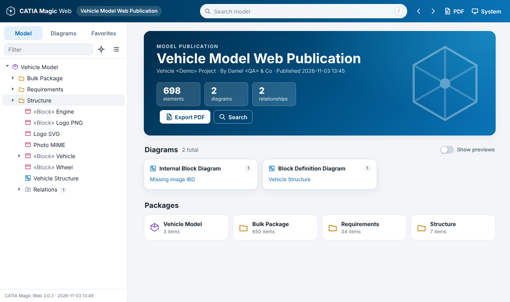

---

## Contents

1. [Quick start](#quick-start)
2. [Using the interface](#using-the-interface)
3. [Template variables](#template-variables)
4. [How it works](#how-it-works)
5. [Performance](#performance)
6. [Development](#development)
7. [Troubleshooting](#troubleshooting)
8. [Repository layout](#repository-layout)

---

## Quick start

### 1. Install the template

Copy `template/CATIA Magic Web 3.0` into your modeling tool's template folder:

```
<install dir>/data/templates/CATIA Magic Web 3.0/
├── template.xml
├── reports/built-in.xml
└── web/ …
```

Or use **Tools ▸ Report Wizard ▸ Import** and select the folder. Restart or refresh the Report Wizard; the template appears under *Default Template*.

### 2. Generate

1. **Tools ▸ Report Wizard**, choose **CATIA Magic Web 3.0**, then **Next**.
2. Pick the report data (`Built-in`) and set variables if needed (see [Template variables](#template-variables)).
3. Select the packages to publish (recursive by default).
4. Choose an output file, e.g. `C:\publish\MyModel.html`, and click **Generate**.

### 3. Open

Double-click `MyModel.html`. Keep it next to its companion folder:

```
MyModel.html          ← the page (about 30 KB)
MyModel_files/
├── css/  js/  images/
├── data/             ← model data, loaded progressively
│   ├── e1.js … eN.js    elements: the model tree (1,500 per file, loaded at startup)
│   ├── o1.js … oN.js    documentation (loaded in the background)
│   ├── d1.js … dN.js    diagram details (10 per file, background or on demand)
│   └── p1.js … pN.js    Specification properties (loaded on demand)
└── …                 ← diagram images and copied attachments
```

To share the publication, zip both together, or copy them to any web server (see [Hosting](#hosting-turn-on-compression)).

---

## Using the interface

### Layout

| Area | What it does |
|---|---|
| **Header** | Logo (home), project name, search, Back/Forward, **PDF** export, theme menu |
| **Sidebar** | **Model** tree, **Diagrams** grouped by type, **Favorites**. Filter box, *locate current element*, *collapse all*. Drag the edge to resize. |
| **Content** | Home page, element pages, search results, PDF preview, About page |

### Loading

The loading card appears immediately and shows its progress (*Loading model elements, part 22 of 40*).
If nothing changes for 10 seconds, a **"Nothing happening?"** checklist appears. It works even when JavaScript is blocked.

Once the model tree has loaded, the interface is usable. Documentation and diagram details keep loading in the background; a small **"Indexing documentation and diagrams… 40 %"** note at the bottom of the sidebar shows the progress.
Opening an element or diagram before then loads just what that page needs.
Documentation search, *Appears in* and PDF export show an "indexing" state and update automatically when indexing completes.

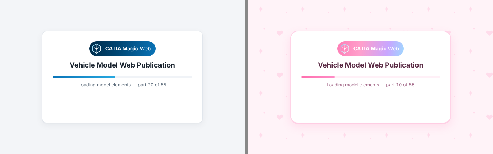

### Model tree

- Click a name to open it; click the arrow to expand it. Relationships are grouped in a **Relations** folder, as in Cameo.
- Large packages show 300 children at a time, followed by a **Show 300 more** button.
- Keyboard: `↑` `↓` move, `→` expands or enters, `←` collapses or goes to the parent, `Home`/`End`, and `Enter` opens.
- **Filter** dims items that don't match. The target button (⌖) reveals the current element in the tree.

### Element pages

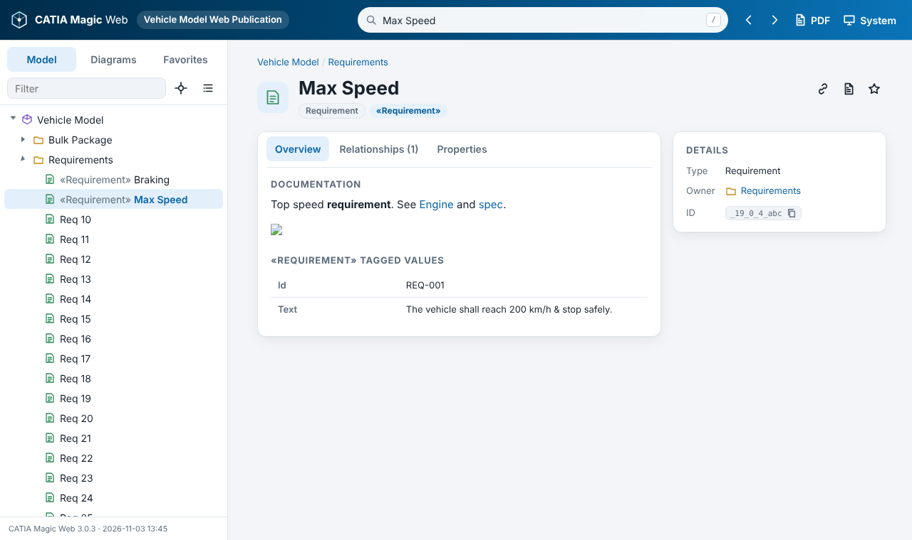

Each element page has:

- **Header:** owner breadcrumb, name, type, stereotype chips, and actions: *copy link*, *export PDF*, *favorite*.
- **Overview tab:** documentation, comment text, image, tagged values, and owned elements grouped by type.
- **Relationships tab:** each relationship with its direction (→ to, ← from, — with) and the related element.
- **Properties tab:** the full Specification property list, loaded on demand, with its own filter box.
- **Shown elements tab** (diagrams only): every element on the diagram.
- **Details panel:** type, owner, a copyable ID, diagram info, and **Appears in** (the diagrams that show the element).

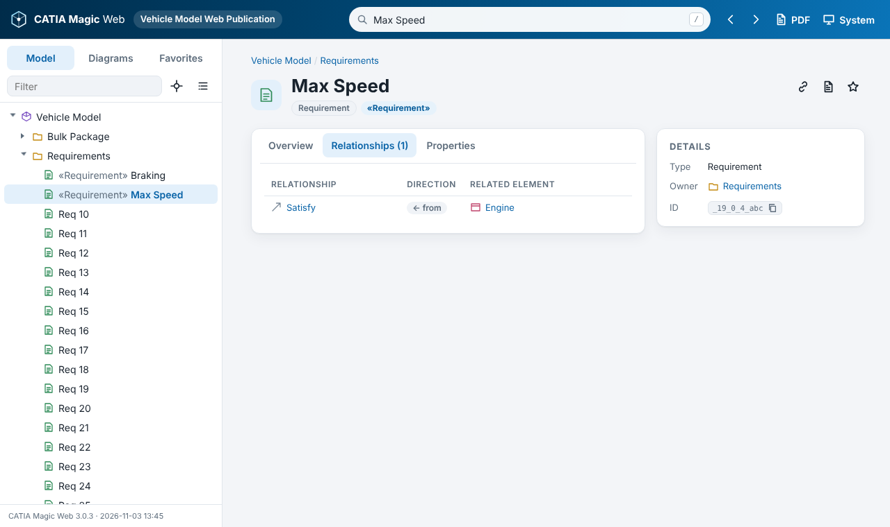

### Rich text and images from the model

- **Documentation, comments/notes, and text fields** stored as HTML (for example, requirement *Text*) are rendered as formatted text. They are sanitized first: no scripts, forms or frames.
- **`mdel://` links** inside documentation become links within the publication.
- **«CustomImageHolder» images** are decoded and displayed: base64 PNG/GIF/JPEG/BMP/WebP, SVG text, or `MIME: image/...` formats. The raw encoding is never shown.

| HTML requirement text | Custom image |
|---|---|
| 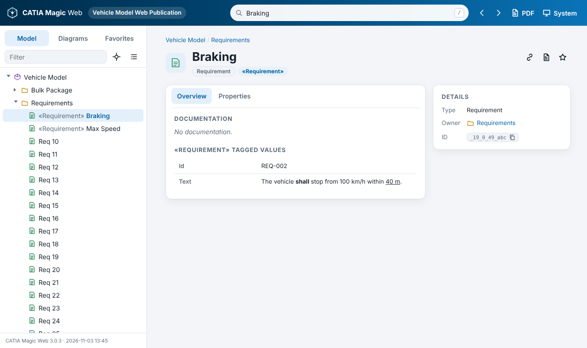 | 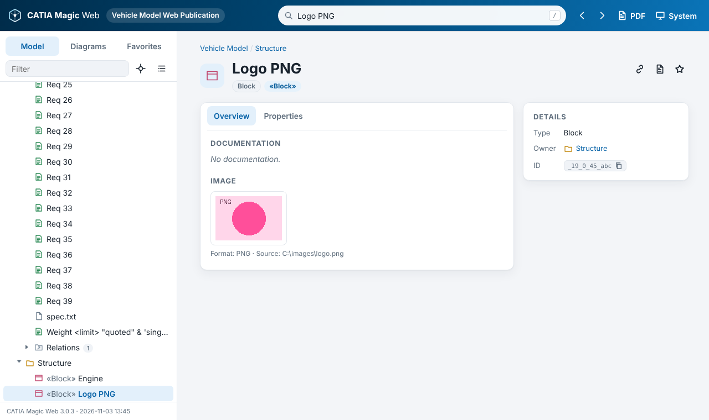 |

### Diagrams

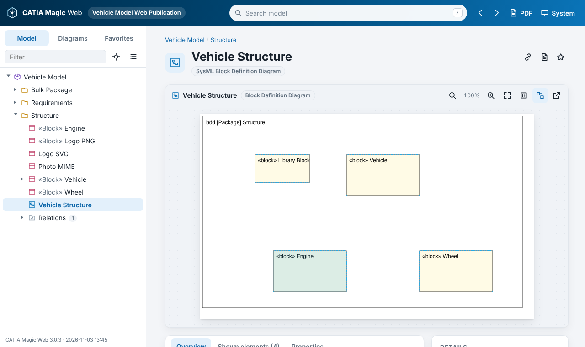

| Action | How |
|---|---|
| Open an element | Click its shape |
| Context menu | Right-click a shape: *Open*, *Show in model tree*, *Copy element ID* |
| Zoom | Toolbar ± buttons, `Ctrl` + mouse wheel, or `+` / `-` keys |
| Fit / 100 % | Toolbar buttons, or `0` / `1` keys |
| Pan | Drag the background (touch: swipe) |
| Show all clickable shapes | Toolbar *outline* toggle |
| Full-size image | Toolbar *open in new tab* |


### Search

Press `/` anywhere to jump to the search box. Suggestions appear as you type; `↑`/`↓` then `Enter` opens one, and `Enter` alone shows all results.

| Query | Finds |
|---|---|
| `brake` | Names containing "brake" (case-insensitive); stereotype and type names also match |
| `/^REQ-\d+$/` | A **regular expression**: wrap the pattern in slashes |
| `/pump|valve/` | Either word |
| `torque` + **Include documentation** | Also searches documentation and comment text |

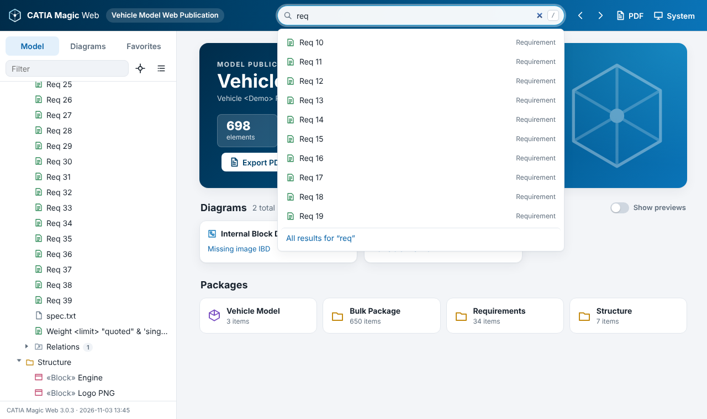

### Links you can share

Every page has its own address, and browser **Back/Forward** work, including from disk.

| URL (after `MyModel.html`) | Opens |
|---|---|
| `#/` | Home page |
| `#/e/<elementId>` | An element or diagram, e.g. `#/e/_2026x_1_2b0010b_1793736907707_788780_2866` |
| `#/search/<text>` | Search results, e.g. `#/search/%2F%5EREQ-%2F` for `/^REQ-/` |
| `#/book/all/-/dr` | PDF preview of the whole model, with diagrams (`d`) and relationships (`r`) |
| `#/book/branch/<elementId>/drp` | PDF preview of one package and everything it contains, plus properties (`p`) |
| `#/about` | About this publication: data files, load times, counts |
| `?refid=<elementId>` | Legacy Web Publisher 2.0 deep link, still supported |

The *copy link* button on an element page copies its address.

### PDF export

Click **PDF** in the header, on the home page, or on any element page.

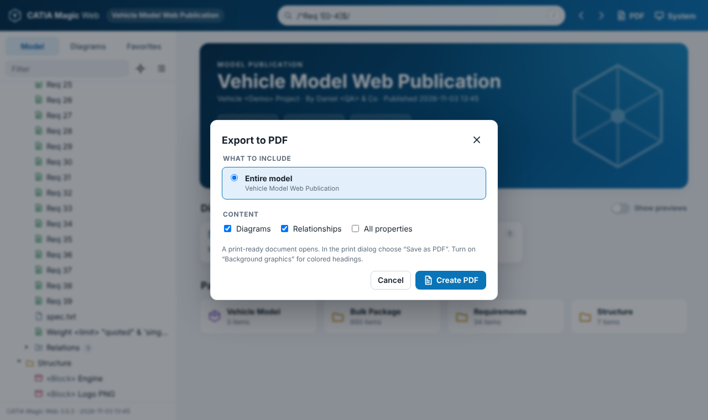

| Scope | Result |
|---|---|
| **This page only** | Prints the current page, with all tabs expanded |
| **This element and its contents** | A report for one package or element and everything it contains |
| **Entire model** | A report for everything published |

The report has a cover page, a clickable table of contents, numbered sections (1, 1.2, 1.2.3 …), numbered figures, documentation, tagged values, relationships, optional properties, and page numbers.
A print-ready preview opens first; in the print dialog choose **Save as PDF** (and enable *Background graphics* for colored headings).
Reports with more than 2,500 sections ask for confirmation first. See [`docs/sample-report.pdf`](docs/sample-report.pdf) for an example.

Pressing `Ctrl+P` on any page also works: the page prints in light colors with every tab expanded.

### Themes

The theme menu in the header offers **System** (follows the OS), **Light**, **Dark** and **Kawaii** (an original pastel theme with hearts and sparkles). Your choice is remembered in the browser.

| Dark | Kawaii |
|---|---|
| 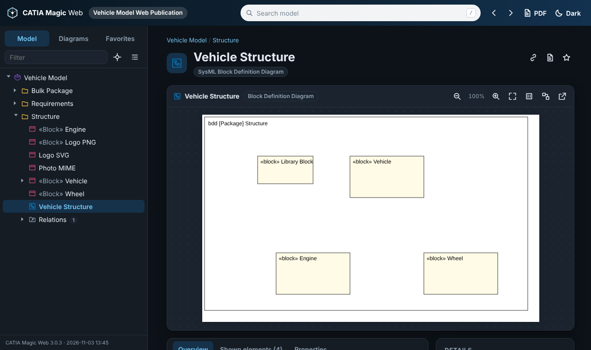 | 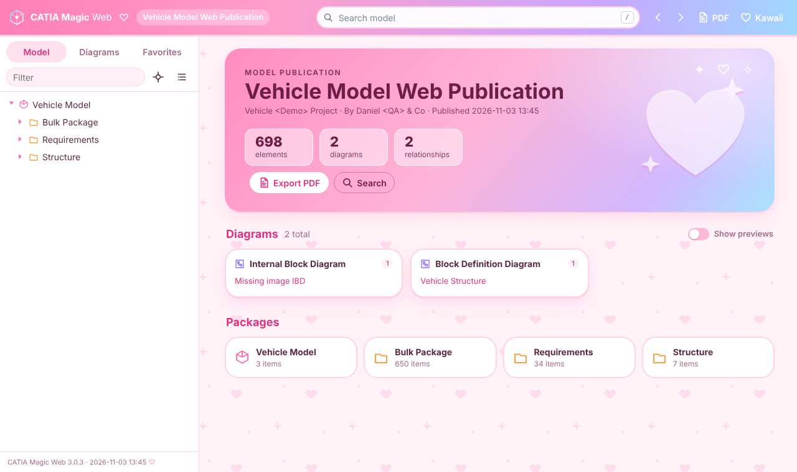 |

### Home page

The home page shows a summary, then diagrams listed by type and the top-level packages.
**Show previews** switches to diagram thumbnails; these load one at a time as they scroll into view, so large models stay fast.

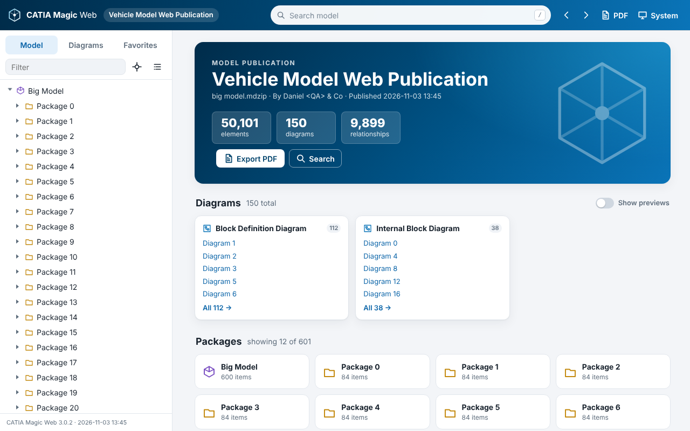

### About this publication

Click the version link at the bottom of the sidebar, or go to `#/about`. It lists every data file, its status and load time, plus element, relationship and diagram counts. Start here when something looks incomplete.

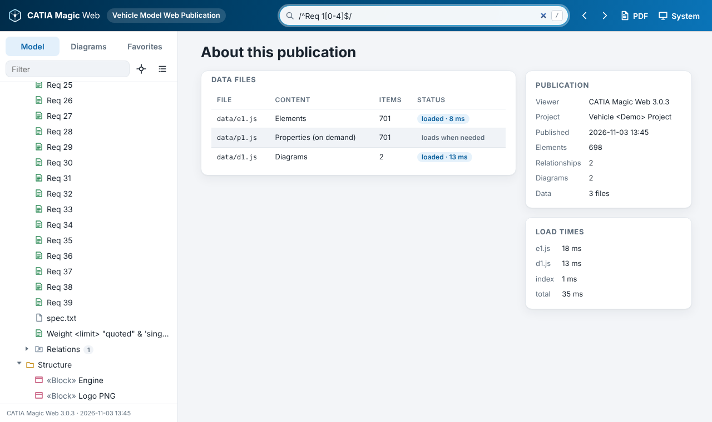

### Phones and tablets

On narrow screens the sidebar becomes a drawer (☰).

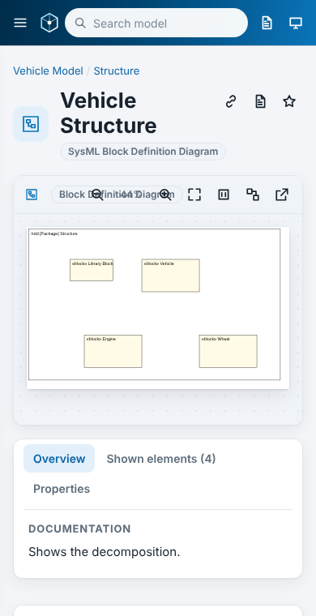

---

## Template variables

Set these in the Report Wizard's report data (`reports/built-in.xml` holds the defaults).

| Variable | Default | Description |
|---|---|---|
| `Title` | `CATIA Magic Web 3.0` | Page and report title (falls back to the project name when empty) |
| `Author` | | Shown on the home page and the PDF cover |
| `HomeImage` | *(empty)* | Empty = overview page. Can also be a **diagram name** (shown on the home page), `mdel://<id>` (that element's image), `file://<path>` (copied into the output) or `http(s)://<url>`. |
| `DataFiles` | `true` | Write data as progressive `data/*.js` files. `false` puts everything inside the page (small models only). |
| `IncludeAllProperties` | `true` | Export the full Specification property list. Turn off to shrink very large publications by about 60 %. |
| `DiagramHotspots` | `true` | Clickable shapes on diagrams |
| `UseContextMenu` | `true` | Right-click menu on diagram shapes |
| `DiagramPreviews` | `false` | Start the home page with thumbnails switched on |
| `ShowAppearsInPage` | `true` | "Appears in" list on element pages |
| `ExportLinkedFile` | `true` | Copy attached files into the output and link them |
| `SVGDiagramResizable` | `true` | Fit diagrams to the window when they open |
| `DisplayTreeElementId` | `false` | Show element IDs in the tree |
| `ShowAppliedStereotypes` | `false` | Show «stereotypes» in the tree |
| `SkipElementContext` | **`false`** | Must stay `false`: the template iterates `$elements` and `$Diagram` |

Set the diagram image format on the Report Wizard's output page; **SVG** (the default) stays sharp at every zoom level.

---

## How it works

### The problem with Web Publisher 2.0

Web Publisher 2.0 writes hundreds of XML files and loads each one with `XMLHttpRequest`.
Browsers block that for pages opened from disk (`file://` is treated as a unique origin), so the publication had to be hosted on a server or opened with special browser flags.

### Architecture

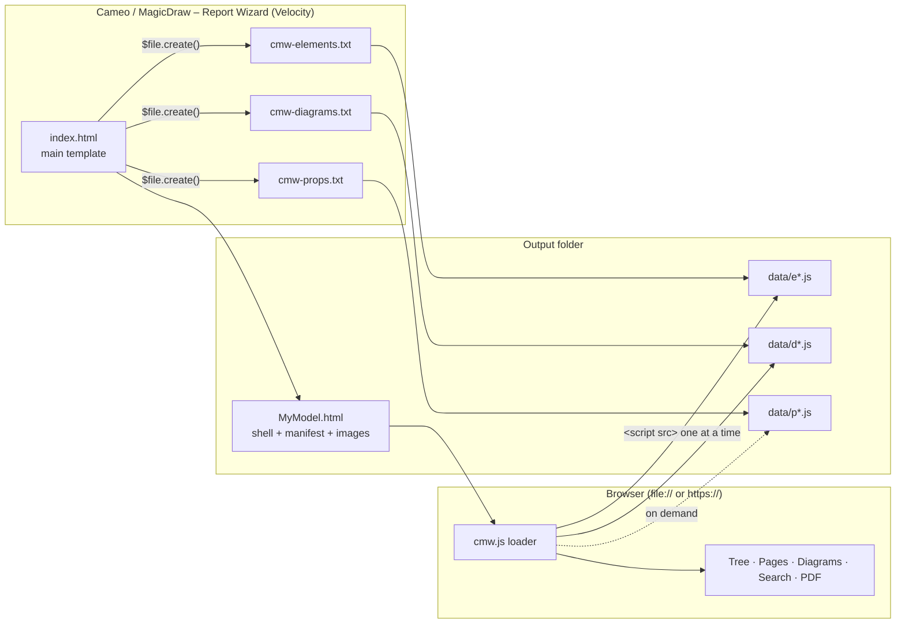

1. **The shell page** (`index.html` template → `MyModel.html`, about 30 KB) contains the loading screen, a manifest of data files, and a small *skeleton* for each diagram: name, type, owner, image, and which detail file holds it. It paints immediately, before any script runs.
2. **The data files** are written by sub-templates through `$file.create(template, output, map)`. Each file is a tiny script:
   ```js
   CMW_CHUNK('e', 3, String.raw`<x-e data-id="_19_0_..." data-t="Block" data-n="Engine"> … </x-e> …`);
   ```
   `<script src>` is allowed from `file://` (unlike `fetch`/XHR), so this works everywhere.
3. **The viewer** (`js/cmw.js`, a classic deferred script, because browsers also block ES modules on `file://`) loads **only the element files** at startup: the model tree, names, types, stereotypes and relationships. It parses each one into an inert `<template>`, pausing every ~40 ms so the progress bar repaints, then builds the containment tree and relationship index.
4. **Background indexing.** Once the first page is on screen, documentation (`o*.js`) and diagram details (`d*.js`: shapes, bounds, documentation) load one file at a time, leaving room for clicks and scrolling between files. The *appears in* index grows as diagram details arrive. A page that needs something not yet indexed loads that one file immediately.
5. **Properties** (about 60 % of the data) load only when a Properties tab opens or a PDF needs them.

### Key techniques

| Concern | Solution |
|---|---|
| Escaping model text | One Velocity macro, `#x()`, escapes `& < > " $` and backtick using only single-quoted literals (no backslashes), so it behaves the same on Velocity 1.7 and 2.x. The output is safe both as HTML and inside a JS `String.raw` template. |
| Rendering model text | Element names and values are inserted with `textContent`. HTML (documentation, comments, rich text fields) goes through DOMPurify. |
| Diagram images | The image object (`$d.image`) is printed **directly** in the main HTML template. That is what makes Report Wizard export the file. Passing it through a macro or `toString()` writes `Image [id=…]` instead. |
| Clickable shapes | `$report.getPresentationElementRectangle()` gives shape bounds in diagram coordinates. The template also records the bounding box of *all* presentation elements (frame, notes, paths). The viewer then works out how the exported image maps onto the diagram; Cameo 2026x images start at the diagram origin with a 25 px margin. |
| Custom images | «CustomImageHolder» `content` + `format` (+ `location`) are turned into a `data:` URL: base64 for raster formats, URL-encoded for SVG. |
| Comments and notes | The template exports `Comment.body`. The viewer renders it as HTML and uses its plain text as the label. |
| Security | A CSP `<meta>` tag allows only same-origin and local scripts. There are no inline scripts or handlers, no `eval`, and DOMPurify 3.4 is bundled. |
| State | Favorites, theme, sidebar width and tab choices go to `localStorage` (wrapped in try/catch; some `file://` setups disable it). |
| Navigation | Hash routes (`#/e/…`) work from disk and keep Back/Forward working. |

### Data format

Inside each data file the markup uses custom tags, which the browser parses without running anything:

```html
<x-e data-id="ID" data-o="OWNER_ID" data-t="Requirement" data-n="Max Speed">
  <x-doc>…escaped documentation (HTML or text)…</x-doc>
  <x-body>…comment text…</x-body>
  <x-s data-n="Requirement"><x-v data-n="Id">REQ-001</x-v></x-s>
</x-e>
<x-e … data-rel="1"><x-src data-ref="A">A</x-src><x-tgt data-ref="B">B</x-tgt></x-e>
<x-d data-id="DIAGRAM_ID" data-t="SysML Block Definition Diagram" …>
  <x-u data-x0="5" data-y0="5" data-x1="705" data-y1="425"></x-u>
  <x-h data-ref="ELEMENT_ID"><x-b data-x="320" data-y="90" data-w="160" data-h="90"></x-b></x-h>
</x-d>
<x-pp data-id="ID"><x-p data-n="Multiplicity"><x-t>1</x-t></x-p></x-pp>     (p*.js)
<x-o data-id="ID"><x-doc>…documentation…</x-doc></x-o>                      (o*.js)
<x-di data-id="ID" data-n="Name" data-t="SysML Block Definition Diagram" data-o="OWNER" data-dc="3">
  </x-di>                                      (page: diagram skeleton)
```

---

## Performance

Measured in headless Chromium from `file://` with a synthetic model (`tests/render-big.js`). Each figure is a range over repeated runs in the same session:

| 60,000 elements · 150 diagrams | 3.0.1 (single file) | 3.0.2 / 3.0.3 (data files) | **3.0.4 (skeleton first)** |
|---|---|---|---|
| Page (`.html`) size | 185 MB | 28 KB | **30 KB** |
| Longest main-thread freeze | 9.5 s | 0.1–0.2 s | **0.1–0.2 s** |
| Usable after | 13.9 s | 3.7–6.8 s | **1.5–2.0 s** |
| Documentation + diagrams fully indexed | (at startup) | (at startup) | **≈ 6 s, in the background** |

Where the time went in 3.0.3: reading the files from disk costs almost nothing. The cost is CPU, spent parsing the markup and building records, so **compressing the data files would not make opening from disk faster**. Loading less at startup does: 3.0.4 parses only the element files before the page is usable, and parses each element's children in one pass.

While background indexing runs, the page keeps responding to clicks; the worst observed delay was about 0.25 s, on this test model's unusually heavy 2,500-shape diagrams.

### Hosting: turn on compression

Over a network, transfer time dominates, and the data compresses very well (5–10× on typical models). You don't need to change the template: enable compression for `.js`, `.css`, `.html` and `.svg` on the web server, and browsers decompress automatically.

**IIS** (install the *Static Content Compression* feature), `web.config` next to the publication:
```xml
<configuration>
  <system.webServer>
    <urlCompression doStaticCompression="true" />
  </system.webServer>
</configuration>
```

**Apache** (`.htaccess`, `mod_deflate` enabled):
```apache
<IfModule mod_deflate.c>
  AddOutputFilterByType DEFLATE text/html text/css application/javascript text/javascript image/svg+xml
</IfModule>
```

**nginx**:
```nginx
gzip on;
gzip_types text/css application/javascript image/svg+xml;
```

GitHub Pages, Netlify, Azure Static Web Apps and similar hosts compress automatically.
SharePoint Online document libraries download `.html` files instead of displaying them, so use a web server or static host instead.

---

## Development

```
source/                 Velocity sources. Edit these, not template/…/web/*.txt or index.html.
├── macros.vm           macros shared by every template (escaping, element, diagram, properties)
├── index.html          main template (shell, data-file loops, image references)
├── cmw-elements.txt    sub-template: elements
├── cmw-diagrams.txt    sub-template: diagram details
├── cmw-props.txt       sub-template: Specification properties
├── cmw-docs.txt        sub-template: documentation
└── build.py            inserts macros.vm into each template → template/CATIA Magic Web 3.0/web/
```

The viewer (`template/…/web/js/cmw.js`) and styles (`web/css/cmw.css`) are edited directly; they need no build step.

### Build and test

The tests render the templates with [velocityjs](https://github.com/shepherdwind/velocity.js) against a mock of the Report Wizard API (`tests/mock.js`). The mock mirrors real Cameo behavior: pre-escaped representation text, image export, and the 25 px anchored image margin. Playwright then exercises the result from `file://`.

```bash
cd tests
npm install
npx playwright install chromium
npm run build          # source/ → template/
npm test               # build + render + 58 browser checks (functional, rich content, failure modes, lazy loading)
npm run big            # 60k-element performance run
npm run screenshots    # regenerate docs/images
```

The test model includes deliberately hostile content (`<script>` in documentation and comments, backticks and `${…}` in names, trailing backslashes) to guard the escaping and sanitizing.

> The mock is not Cameo. After changing a template, generate a real report in Cameo and check `#/about`.

---

## Troubleshooting

| Symptom | Cause / fix |
|---|---|
| Loading card stays on "Opening publication…" | Scripts didn't run. Keep `MyModel.html` next to `MyModel_files/`; press F12 and check the Console. |
| "No model data found" | The `data/` folder is missing. If it was never generated, check the Report Wizard log, or set `DataFiles = false` as a fallback. |
| Yellow banner "x of y data files could not be loaded" | Some files are missing; `#/about` lists which ones. |
| Diagrams show "No image was exported" | The output was generated with 3.0.0; regenerate with 3.0.1 or later. |
| Clickable shapes slightly offset | A diagram whose frame isn't at the origin, or a custom image export margin. Use the *Shown elements* tab as a fallback, and report the diagram. |
| Favorites/theme not remembered | The browser blocks `localStorage` for local files (some Firefox/enterprise settings). Everything else still works. |
| Very large output | Use SVG diagram images; set `IncludeAllProperties = false`. |
| Hosted publication loads slowly | Turn on gzip/Brotli compression on the server; see [Hosting](#hosting-turn-on-compression). |

### Compatibility

- **Browsers:** current Chrome, Edge, Firefox and Safari. Tested in Chromium, from both `file://` and HTTP.
- **Tools:** Report Wizard in Cameo / MagicDraw / CATIA Magic 2021x – 2026x (Velocity 1.7 and 2.x safe constructs). Verified against Cameo 2026x output.
- **Old outputs:** the viewer still opens 3.0.0 and 3.0.1 publications.

---

## Repository layout

```
template/CATIA Magic Web 3.0/   the installable Report Wizard template
source/                         Velocity sources and build script
tests/                          mock Report Wizard + Playwright test suites
docs/images/                    screenshots used in this README
docs/sample-report.pdf          example PDF export
CHANGELOG.md
```

## Third-party software

- [DOMPurify](https://github.com/cure53/DOMPurify) 3.4.17. Apache-2.0 / MPL-2.0, bundled in `web/js/vendor/` with its license.

CATIA, Cameo and MagicDraw are trademarks of Dassault Systèmes.
